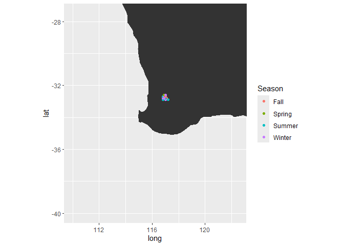
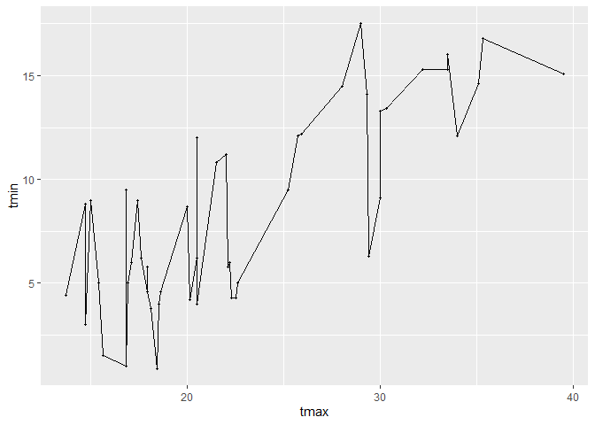
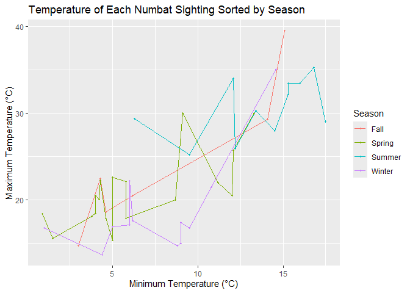
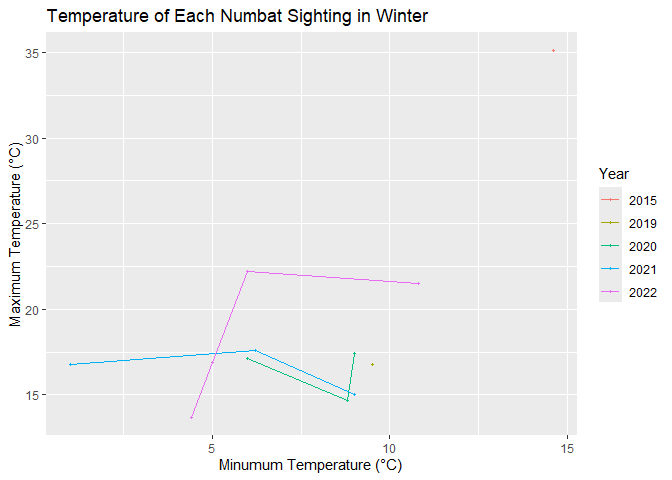
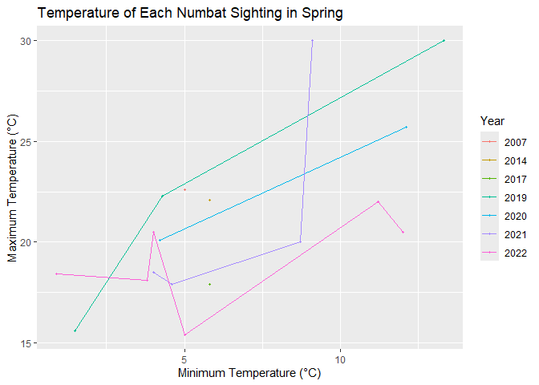
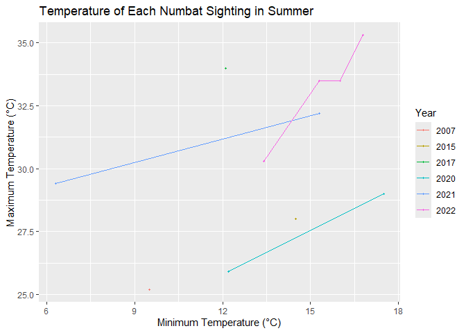
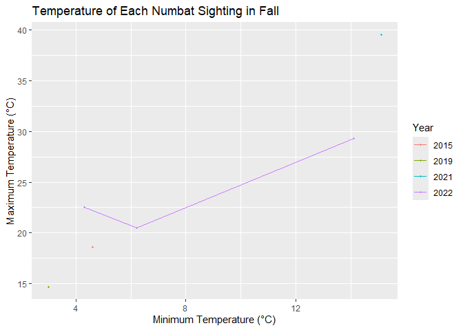

# William_Burgett-Merkel_Datasprint


**Project: Midterm Datasprint** **Name: William Burgett-Merkel**

**Introduction**

This dataset is the observations of Numbats in Australia. The reason
this dataset exists is because Numbats are an endangered species, and
tracking observations is important to ensure their habitat is protected.
The main variables are the species name, latitude, longitude, the date
and time of the observations, the day of the week the observation
occured, the maximum and minimum temperature in celsius of the day the
Numbat was observed, and precipitation that day in millimeters.

I wanted to answer 3 questions from this dataset. 1. Where do the
observations occur that actually have temperature data, and why only
these observations? 2. What season are Numbats spotted most frequently
and how are temperatures changing in these seasons by year? 3. Are there
more cool or warm day observations?

**Analysis**

``` r
#| label: setup
#| include: false

library(tidyverse)
```

    ── Attaching core tidyverse packages ──────────────────────── tidyverse 2.0.0 ──
    ✔ dplyr     1.2.1     ✔ readr     2.2.0
    ✔ forcats   1.0.1     ✔ stringr   1.6.0
    ✔ ggplot2   4.0.3     ✔ tibble    3.3.1
    ✔ lubridate 1.9.5     ✔ tidyr     1.3.2
    ✔ purrr     1.2.2     
    ── Conflicts ────────────────────────────────────────── tidyverse_conflicts() ──
    ✖ dplyr::filter() masks stats::filter()
    ✖ dplyr::lag()    masks stats::lag()
    ℹ Use the conflicted package (<http://conflicted.r-lib.org/>) to force all conflicts to become errors

``` r
library(knitr)
library(sf)
```

    Linking to GEOS 3.14.1, GDAL 3.12.1, PROJ 9.7.1; sf_use_s2() is TRUE

``` r
library(tmap)

knitr::opts_chunk$set(echo = TRUE)
```

Get the data and then filter out any rows that do not have temperature
values. Then create a column for what season the month occurred in based
on Australian Climate. Finally plot the sightings with temperature data
based on location in Australia.

``` r
numbats <- read_csv("data/numbats.csv")
```

    Rows: 805 Columns: 16
    ── Column specification ────────────────────────────────────────────────────────
    Delimiter: ","
    chr  (6): scientificName, taxonConceptID, recordID, dataResourceName, month,...
    dbl  (7): decimalLatitude, decimalLongitude, year, hour, prcp, tmax, tmin
    lgl  (1): dryandra
    dttm (1): eventDate
    date (1): day

    ℹ Use `spec()` to retrieve the full column specification for this data.
    ℹ Specify the column types or set `show_col_types = FALSE` to quiet this message.

``` r
numbats_filtered<-numbats |> 
  filter(!is.na(tmax))

numbats_filtered<-numbats_filtered |> 
  filter(!is.na(tmin))

kable(head(numbats_filtered))
```

| decimalLatitude | decimalLongitude | eventDate | scientificName | taxonConceptID | recordID | dataResourceName | year | month | wday | hour | day | dryandra | prcp | tmax | tmin |
|---:|---:|:---|:---|:---|:---|:---|---:|:---|:---|---:|:---|:---|---:|---:|---:|
| -32.9 | 116.8 | 2022-12-18 04:05:09 | Myrmecobius fasciatus | https://biodiversity.org.au/afd/taxa/6c72d199-f0f1-44d3-8197-224a2f7cff5f | 68f671a7-cf6d-4d32-982f-56499295527d | iNaturalist Australia | 2022 | Dec | Sun | 4 | 2022-12-18 | TRUE | 0.0 | 30.3 | 13.4 |
| -32.9 | 117.2 | 2022-02-15 19:16:00 | Myrmecobius fasciatus | https://biodiversity.org.au/afd/taxa/6c72d199-f0f1-44d3-8197-224a2f7cff5f | b306731b-0d56-4532-b60f-620dd26e4265 | Earth Guardians Weekly Feed | 2022 | Feb | Tue | 19 | 2022-02-15 | TRUE | 0.0 | 35.3 | 16.8 |
| -32.9 | 117.0 | 2022-08-21 06:05:00 | Myrmecobius fasciatus | https://biodiversity.org.au/afd/taxa/6c72d199-f0f1-44d3-8197-224a2f7cff5f | b508b9ea-1db0-49c3-a7e3-c231dcb326c6 | iNaturalist Australia | 2022 | Aug | Sun | 6 | 2022-08-21 | TRUE | 0.0 | 16.9 | 5.0 |
| -32.8 | 116.9 | 2021-12-19 03:13:00 | Myrmecobius fasciatus | https://biodiversity.org.au/afd/taxa/6c72d199-f0f1-44d3-8197-224a2f7cff5f | 0381d001-66c2-4d3e-91c6-97c6e92fa57a | iNaturalist Australia | 2021 | Dec | Sun | 3 | 2021-12-19 | TRUE | 0.2 | 29.4 | 6.3 |
| -32.8 | 116.8 | 2021-09-20 05:57:00 | Myrmecobius fasciatus | https://biodiversity.org.au/afd/taxa/6c72d199-f0f1-44d3-8197-224a2f7cff5f | 3da9de3f-aca4-420a-ab3a-ce12c639f13d | iNaturalist Australia | 2021 | Sep | Mon | 5 | 2021-09-20 | TRUE | 0.8 | 18.5 | 4.0 |
| -32.8 | 117.1 | 2021-03-29 19:47:43 | Myrmecobius fasciatus | https://biodiversity.org.au/afd/taxa/6c72d199-f0f1-44d3-8197-224a2f7cff5f | 42dff9a9-a68a-4b7c-92c6-4699c55a7018 | iNaturalist Australia | 2021 | Mar | Mon | 19 | 2021-03-29 | TRUE | 0.0 | 39.5 | 15.1 |

``` r
numbats_seasons<-numbats_filtered
  seasons<- c(
    "Dec" = "Summer", "Jan" = "Summer", "Feb" = "Summer",
    "Mar" = "Fall", "Apr" = "Fall", "May" = "Fall",
    "Jun" = "Winter", "Jul" = "Winter", "Aug" = "Winter",
    "Sep" = "Spring", "Oct" = "Spring", "Nov" = "Winter"
  )
  numbats_seasons$Season<-seasons[numbats_filtered$month]

australia_map <- map_data("world", region = "Australia")

ggplot()+
geom_polygon(data=australia_map,
              aes(x = long,
                  y = lat,
                  group = group))+

geom_point(data = numbats_seasons,
       aes(x=decimalLongitude,
           y=decimalLatitude,
           color=Season))+

  coord_quickmap(xlim=c(110, 122.5),
                 ylim=c(-40,-27.5))
```



Take the original dataset, filter out any rows that did not have a month
in it, set the seasons based on Australia climate, and get the total
observations in each season.

``` r
numbats_filtered_all<-numbats |> 
  filter(!is.na(month))

numbats_seasons_all<-numbats_filtered_all
  seasons<- c(
    "Dec" = "Summer", "Jan" = "Summer", "Feb" = "Summer",
    "Mar" = "Fall", "Apr" = "Fall", "May" = "Fall",
    "Jun" = "Winter", "Jul" = "Winter", "Aug" = "Winter",
    "Sep" = "Spring", "Oct" = "Spring", "Nov" = "Winter")
  
  numbats_seasons_all$Season<-seasons[numbats_filtered_all$month]

numbats_seasons_all_count<-numbats_seasons_all %>%
  count(Season)
```

Get the mean min and max temperature. Then plot the observations with
the tmax as the x and tmin as y to see the overall days when the events
occurred. Also get the count of observations in each season.

``` r
numbats_mean_tmin<-numbats_filtered |> 
  summarize(mean_tmin=mean(tmin),
            mean_tmax=mean(tmax))

numbats_seasons_count<-numbats_seasons %>%
  count(Season)

ggplot(numbats_filtered,
       aes(x=tmax, 
           y=tmin))+
  geom_line(size=.5)+
  geom_point(size=.75)
```

    Warning: Using `size` aesthetic for lines was deprecated in ggplot2 3.4.0.
    ℹ Please use `linewidth` instead.



Group the months into seasons, then plot the observations by season.

``` r
ggplot(numbats_seasons,
       aes(x=tmin, 
           y=tmax,
           group=Season,
           color=Season))+
  geom_line(size=.5)+
  geom_point(size=.75)+
  labs(title="Temperature of Each Numbat Sighting Sorted by Season",
     x="Minimum Temperature (°C)",
     y="Maximum Temperature (°C)",
     color="Season")
```



``` r
ggplot(numbats_seasons[numbats_seasons$Season == "Winter", ],
       aes(x=tmin, 
           y=tmax,
           color=factor(year)
           ))+
  geom_line(size=.5)+
  geom_point(size=.75)+
   labs(title="Temperature of Each Numbat Sighting in Winter",
     x="Minumum Temperature (°C)",
     y="Maximum Temperature (°C)",
     color="Year")
```



``` r
ggplot(numbats_seasons[numbats_seasons$Season == "Spring", ],
       aes(x=tmin, 
           y=tmax,
           color=factor(year)))+
  geom_line(size=.5)+
  geom_point(size=.75)+
  labs(title="Temperature of Each Numbat Sighting in Spring",
     x="Minimum Temperature (°C)",
     y="Maximum Temperature (°C)",
     color="Year")
```



``` r
ggplot(numbats_seasons[numbats_seasons$Season == "Summer", ],
       aes(x=tmin, 
           y=tmax,
           color=factor(year)))+
  geom_line(size=.5)+
  geom_point(size=.75)+
  labs(title="Temperature of Each Numbat Sighting in Summer",
     x="Minimum Temperature (°C)",
     y="Maximum Temperature (°C)",
     color="Year")
```



``` r
ggplot(numbats_seasons[numbats_seasons$Season == "Fall", ],
       aes(x=tmin, 
           y=tmax,
           color=factor(year)))+
  geom_line(size=.5)+
  geom_point(size=.75)+
labs(title="Temperature of Each Numbat Sighting in Fall",
     x="Minimum Temperature (°C)",
     y="Maximum Temperature (°C)",
     color="Year")
```



**Discussion**

1.  All observations with temperature data points are tightly packed in
    a small area in Western Australia. This is likely because there is a
    more official reporting methodology in this location.

2.  As I stated in \#1, spring and winter were the most frequent season
    for observations in sightings that had temperature data. However,
    when looking at all sightings (as long as they had dates), winter
    and summer had the most observations with 235 and 217 sightings
    each, with spring and fall far behind them with 71 and 29
    respectively.

3.  There are more observations in cooler days, as there is a larger
    clump of data in lower tmin and tmax values. This correlates with
    the fact that winter and spring had the most observations.

**Tie to class**

In this exercise, I showed I can handle datasets and orangize them to
get results. I also showed I can create graphs and maps with relevant
data, including latitude and longitude. Furthermore I learned how to
group data to create a new column in a dataset. Lastly, I practiced
skills involving making plots so that each line in a line graph was easy
to interpret using color schemes.

I learned how to wrangle messy data by filtering and grouping data. I
also continued to practice creating line charts and how to correctly
give each variable a color to improve the plot visually. Lastly I
created tabular data that is easy to interpret.
